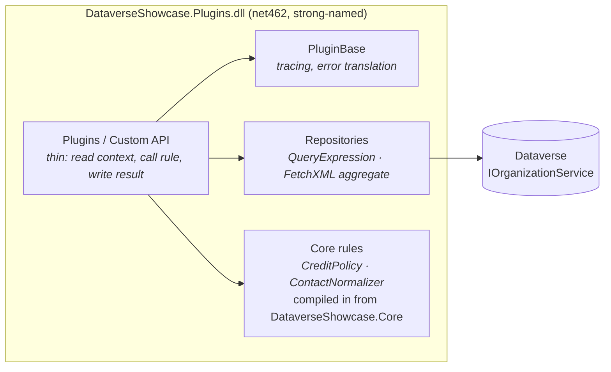

# Dataverse Plugins Showcase

[](https://github.com/ucciefmhmd/dataverse-plugins-showcase/actions/workflows/ci.yml)


C# **Dataverse plugins** and a **Custom API** for Microsoft Dynamics 365 / Power Platform. They're written the way I structure plugin code: business rules kept out of the SDK, thin plugins, safe error handling, and automated tests that run the plugins through the real `IPlugin.Execute` entry point.

Everything works on **standard tables** (`account`, `contact`, `salesorder`). It's an independent sample with fictional data (Contoso, Fabrikam, …): no employer or client code.

> **Scope, stated honestly:** this repository is tested against an in-memory fake of `IOrganizationService` (see *Testing*). It isn't deployed to a Dataverse environment by CI. [Registration steps](docs/registration.md) are included so you can deploy it to a trial or developer environment.

## What's inside

| Component | Type | What it does |
|---|---|---|
| [`ContactDataQualityPlugin`](src/DataverseShowcase.Plugins/Plugins/ContactDataQualityPlugin.cs) | Plugin: `contact` Create/Update, PreOperation | Normalises email (trimmed, lower case) and phone numbers (digits with an optional `+`, and `00` becomes `+`), rejects malformed values, and blocks a second **active** contact with the same email |
| [`AccountCreditLimitGuardPlugin`](src/DataverseShowcase.Plugins/Plugins/AccountCreditLimitGuardPlugin.cs) | Plugin: `account` Update, PreOperation | Refuses to lower `creditlimit` below the customer's **open sales orders** (active and submitted), summed by a FetchXML aggregate |
| [`GetCustomerCreditSummaryApi`](src/DataverseShowcase.Plugins/CustomApis/GetCustomerCreditSummaryApi.cs) | Custom API `ysm_GetCustomerCreditSummary` | Returns the credit limit, open orders total, available credit, utilisation % and a status (`WithinLimit`, `NearLimit`, `OverLimit`, `OnHold`, `NoLimit`) |

## Design



* **Rules without the SDK.** `CreditPolicy` and `ContactNormalizer` live in `DataverseShowcase.Core` (netstandard2.0) and have no `Microsoft.Xrm.Sdk` reference, so they're unit tested on .NET 10 in milliseconds. Their source files are **compiled into** the plugin assembly, so there's still a single DLL to register and no dependent-assembly packaging.
* **Thin plugins.** Each plugin reads its context, calls a rule, and writes the result or throws a message for the user. The Dataverse queries sit in small repositories (`CreditRepository`, `ContactRepository`).
* **`PluginBase`** traces entry and exit with the correlation id, lets `InvalidPluginExecutionException` through unchanged, and wraps everything else (including `FaultException<OrganizationServiceFault>`) in a safe message carrying the correlation id. Details go to the plug-in trace log, never to the user.
* **Registration checks.** Plugins verify their message, table and stage, and fail with a clear message if they're registered wrongly.
* **Least privilege by default.** The Custom API uses the **caller's** permissions (`UserService`). Only the checks that must see every record (duplicate email, totals of all open orders) use the SYSTEM service, and the code says why.
* **Efficient queries.** Narrow `ColumnSet`s, `TopCount = 1` for existence checks, and a server-side FetchXML `sum` instead of loading orders into the plugin.
* **Stateless.** Dataverse caches plugin instances and calls them concurrently, so the plugins keep no instance state.

## Calling the Custom API

```http
GET [organization-url]/api/data/v9.2/ysm_GetCustomerCreditSummary(AccountId=@id)?@id=a1f0c0de-0000-4000-8000-000000000001
```

```json
{
  "CreditLimit": 50000.0,
  "OpenOrdersTotal": 42500.0,
  "AvailableCredit": 7500.0,
  "UtilisationPercent": 85.0,
  "Status": "NearLimit"
}
```

The definition (parameters and types) is in [docs/custom-api.md](docs/custom-api.md).

## Building and testing

Requirements: Windows (the plugin tests run on .NET Framework 4.8) and the .NET 10 SDK.

```bash
dotnet build
dotnet test     # 58 tests: core rules on .NET 10, plugins on .NET Framework 4.8
```

* **Core tests:** credit status thresholds (80% = near limit), hold and no-limit cases, limit-change rules, and email and phone normalisation with valid and invalid inputs.
* **Plugin tests** run each plugin through `IPlugin.Execute` with a fake service provider, execution context, tracing service and an in-memory `IOrganizationService`. The fake evaluates `QueryExpression` filters and **FetchXML sum aggregates**, and it throws on anything it doesn't support, so a test can't pass by accident. Cases include:
  * duplicate emails (case-insensitive), reusing an inactive contact's email, and an update keeping its own email;
  * an open-orders total that excludes canceled and invoiced orders;
  * the Custom API output for each status;
  * SYSTEM vs. caller context;
  * wrong registration, and safe error messages.

Sample data is in [`tests/DataverseShowcase.Plugins.Tests/SampleData.cs`](tests/DataverseShowcase.Plugins.Tests/SampleData.cs).

## Deploying to an environment

See [docs/registration.md](docs/registration.md): register the signed assembly with the Plugin Registration Tool (or `pac`), add the steps listed there, and create the Custom API from [docs/custom-api.md](docs/custom-api.md).

`DataverseShowcase.snk` is a **public sample signing key** so the project builds out of the box. Use your own key for anything real.

## Project layout

```
src/
  DataverseShowcase.Core/      Business rules (netstandard2.0, no Dataverse SDK)
  DataverseShowcase.Plugins/   Plugins, Custom API, PluginBase, repositories (net462)
tests/
  DataverseShowcase.Core.Tests/     .NET 10
  DataverseShowcase.Plugins.Tests/  .NET Framework 4.8, with fakes and sample data
docs/
  registration.md   Plugin steps and deployment
  custom-api.md     Custom API definition
```

## License

[MIT](LICENSE)
